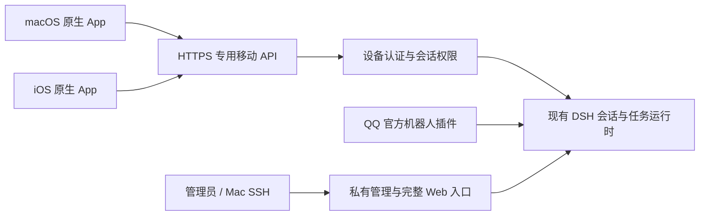

# 小云原生客户端的远程连接与续聊方案

核实日期：2026-11-06。调研只使用标准、平台官方文档和本项目源码；下文分别标注标准要求与项目建议。具体实现、部署和验收记录见[原生会话接口](./ios-companion.md)。

## 建议

**当前继续使用已有 HTTPS 移动网关、设备配对和受限会话 API，让 macOS 与 iOS 共用同一 Swift 客户端。** 不必为了首版先重建一套 OAuth 系统。面向云乐坊统一账号和更多用户时，再接入现有身份服务，以系统浏览器认证、Authorization Code + PKCE 和可撤销的设备会话演进。

网络可达、设备授权、会话同步是三个独立问题。VPN 或 Tunnel 解决连接，登录和权限决定能做什么，服务端会话 ID 与历史协议决定能否接续；任何一项都不能替代另外两项。下图是本项目的建议边界，不是某项标准规定的唯一架构。

## 本项目已有基础

`packages/mobile/src/auth.ts`、`http.ts`、`proxy.ts` 和 Apple 共享客户端已实现下列基础。以下描述源码边界，不能代替[线上验收](./ios-companion.md#本轮验收)：

- 管理员通过 SSH 生成配对码；8 位字符来自 32 字符字母表，有效期 5 分钟、仅兑换一次；配对兑换全局限制为每分钟 20 次。
- 每台设备取得独立的 256 bit 随机 bearer，有效期 30 天。服务器只存摘要，每次请求重新检查到期与撤销状态；客户端使用 Keychain 的 `WhenUnlockedThisDeviceOnly`。
- 公网代理只转发 `/el-bot/mobile/v1/`，没有挂载 DSH home，不转发 DSH 通用 RPC、文件 API、桌面登录页或 WebSocket upgrade。
- 移动 API 复用 DSH 会话 ID 和请求 ID；现有客户端采用前台轮询，运行中 2 秒、空闲 5 秒，尚非逐字流式聊天。

这已经适合做个人设备的首版基础。接下来应先复用、核验并补齐缺少的客户端能力，而不是再平行部署一个无差别代理。配对设备当前能读取和续聊该实例的会话，只适合可信的本人设备；以后增加其他用户时，需要真正的账号、实例和会话授权。

## 接入方式比较

| 方案 | 官方能力与约束 | 本项目建议 |
| --- | --- | --- |
| HTTPS + 专用 API 网关 | 标准 HTTP 客户端可直接访问；Apple 的 URL Loading System 默认执行 ATS 和服务器信任检查。[Apple ATS](https://developer.apple.com/documentation/bundleresources/information-property-list/nsapptransportsecurity) | 作为日常原生 App 的主入口，复用已有域名和移动代理；DSH 管理面继续私有。 |
| 私人 VPN，例如 Tailscale | 可对用户、设备、目标与端口设 grants；应用仍需实现自己的业务授权，不能把网络连通等同于会话权限。[Tailscale grants](https://tailscale.com/docs/features/access-control/grants) | 适合只给自己使用、愿意安装并维持 VPN 的设备，也可用于管理员入口；无需强制所有未来用户采用。 |
| SSH 本地转发 | `ssh -L` 把本地监听端口转发到远端地址，可明确只绑定 loopback。[OpenSSH 手册](https://man.openbsd.org/ssh#L) | 保留为 Mac 管理和调试方式。把隧道留在 Mac 上不会让 iPhone 自动访问；不把 iOS 的长驻 SSH 作为聊天前提。 |
| Cloudflare Tunnel + Access | Tunnel 通过出站连接接通源站；Access 负责访问策略，二者职责不同。[Tunnel](https://developers.cloudflare.com/cloudflare-one/networks/connectors/cloudflare-tunnel/)、[Access 自托管应用](https://developers.cloudflare.com/cloudflare-one/access-controls/applications/http-apps/self-hosted-public-app/) | 源站不可直接公开连接时可选。现有 HTTPS 入口可用时，无需为接入手机再加一层。原生 API 需要实际完成 Access 认证，浏览器能打开不证明 App 能调用。 |

Cloudflare Service Token 是 Client ID / Client Secret 形式的机器凭据。不能把所有安装包共用的服务密钥编进 App 来绕过交互登录；分发到用户设备的静态秘密不能当作保密的客户端身份。[Cloudflare Service Tokens](https://developers.cloudflare.com/cloudflare-one/access-controls/service-credentials/service-tokens/)、[RFC 8252 §8.5](https://www.rfc-editor.org/rfc/rfc8252.html#section-8.5)

## 登录和令牌：标准与当前阶段分开处理

### 面向统一账号时采用原生 OAuth 流程

**标准要求：** 原生 OAuth 客户端通过外部用户代理认证，公开客户端使用 PKCE；安装包内的共享 secret 不能证明客户端身份。回调 URI 必须按登记规则验证，并防止认证响应串入别的登录尝试。[RFC 8252 §6、§8](https://www.rfc-editor.org/rfc/rfc8252.html#section-6)、[RFC 9700 §2.1](https://www.rfc-editor.org/rfc/rfc9700.html#section-2.1)

**平台实践：** Apple 提供 `ASWebAuthenticationSession`，让系统处理认证浏览器和回调接收。使用系统认证会话，不在业务 `WKWebView` 中收集云乐坊密码；具体回调 API 需要符合 macOS 14 / iOS 17 的部署下限。[Apple AuthenticationServices](https://developer.apple.com/documentation/authenticationservices/aswebauthenticationsession)

**项目建议：** 原生 App 以后直接作为公开客户端接入云乐坊身份服务；专用网关负责稳定业务接口和资源授权。浏览器 BFF 的 cookie 会话不是原生 App 必须照搬的架构，也不需要把 DSH owner 登录 cookie 分发到每台手机。

### 个人首版可以保留现有一次性配对

RFC 8628 的 Device Authorization Grant 主要服务缺少浏览器或输入受限的设备，包含特定端点和交互。当前管理员生成短码、手机兑换设备凭据是**自定义配对协议**，不能因此称为符合 RFC 8628 的 OAuth Device Flow；但可借鉴它对短码熵、有效期、限流和钓鱼的要求。[RFC 8628 §1、§5](https://www.rfc-editor.org/rfc/rfc8628.html#section-5)

按当前单份有效配对码、均匀 40 bit 随机空间和 5 分钟最多约 100 次猜测计算，理想随机命中的上界约为 `100 / 2^40 ≈ 9.1 × 10^-11`。这是本项目参数的推算，不是协议安全证明；还要维持一次性原子兑换、可信管理员生成、限流不可绕过，且不能把长期设备 bearer 当作配对二维码传播。

### 30 天单 bearer 的取舍

bearer 的持有者就能使用其权限；HTTPS 和服务器证书验证用于防止传输中泄露，令牌应放在认证请求头而非 URL。短时效可以缩短泄露影响窗口。[RFC 6750 §2.1、§5](https://www.rfc-editor.org/rfc/rfc6750.html#section-5)

**项目判断：** 对可信本人设备，现有「每设备独立随机凭据 + 服务器摘要 + 逐请求可撤销 + Keychain + 限定 API」可以作为 MVP。30 天不是“短效 access token”：若被盗且没有主动撤销，攻击者可能使用到过期。摘要防止设备状态文件直接泄出可用 bearer；Keychain 保护本机保存，二者都不能让已经被取走的 bearer 自动失效。

Keychain 的 `WhenUnlockedThisDeviceOnly` 适合只在前台使用的凭据，设备锁定时不可读，并且不会迁移到另一台设备；这也意味着换机后应重新配对，而不是让两台设备共享同一身份。[Apple Keychain 可访问性](https://developer.apple.com/documentation/security/restricting-keychain-item-accessibility)、[WhenUnlockedThisDeviceOnly](https://developer.apple.com/documentation/security/ksecattraccessiblewhenunlockedthisdeviceonly)

**后续建议：** 多用户或敏感能力扩大时，改成每设备短时 access token、受保护的 refresh token 和设备撤销。比如 access 5–15 分钟属于工程选择，不是 RFC 强制时长。采用 OAuth 时，公开客户端的 refresh token 必须使用发送方绑定或刷新轮换；轮换需要检测重用、撤销关联授权，不能只增加一个 refresh 接口。[RFC 9700 §2.2.2、§4.14](https://www.rfc-editor.org/rfc/rfc9700.html#section-4.14)

## 跨设备续聊应以服务端状态为准

Matrix 的官方协议把消息重传与新消息区分开，用客户端 transaction ID 实现幂等；同步通过服务端返回的游标继续读取，并明确处理历史缺口。这里借鉴其设计原则，不引入 Matrix 服务或要求 DSH 使用同一种协议。[Matrix transaction IDs](https://spec.matrix.org/v1.19/client-server-api/#transaction-identifiers)、[Matrix syncing](https://spec.matrix.org/v1.19/client-server-api/#syncing)

**项目建议：**

1. Mac、iPhone、Web 和 QQ 继续引用同一 DSH session ID。客户端缓存用于展示，模型上下文、任务和历史的权威副本仍在服务端。
2. 一次发送先产生稳定 request ID。网络超时后先查服务端收据或历史，再以同一 ID 重试；服务端去重必须覆盖并发与重启，不能只靠按钮暂时禁用。
3. 打开会话先取得快照和确切游标，再接后续事件；重连、换设备或发现序号缺口时重新补齐。按会话和事件身份去重，丢弃已切换会话的旧连接数据。
4. 现有前台轮询可先完成可靠接续；要改善逐字输出，再在同一受限网关增加 SSE 或 WebSocket 事件通道。传输重连不等于历史恢复，临时文本增量仍需由服务端持久结果校正。
5. 客户端断开只停止观察，不能自动取消云端任务；用户点取消才发送取消操作。审批由服务端保存待决状态、校验身份和有效期，不能因另一端重连而自动同意或重复执行。

App 续聊一个 QQ 关联会话，与把 App 的消息或回复再次发送到 QQ 是两个动作。后者仍应遵守 QQ 插件的目标、消息上下文和被动回复预算；历史刷新、网络重连和手机回前台都不应触发 QQ 发消息。

## iOS 后台策略

iOS App 进入后台后通常会被挂起，临时后台执行用于完成有限工作，不能据此承诺永久聊天连接。模型和 QQ 连接应继续留在服务器；手机回前台后恢复会话、收据和事件游标。[Apple 后台执行](https://developer.apple.com/documentation/uikit/extending-your-app-s-background-execution-time)

需要完成提醒时，可再加入 APNs。后台通知由系统调度，送达不保证，因此推送只能提示“有更新”，不能作为唯一消息记录或续聊依据。不要通过静默推送维持逐字输出。[Apple 后台通知](https://developer.apple.com/documentation/usernotifications/pushing-background-updates-to-your-app)

## 本项目推进顺序

| 阶段 | 交付重点 |
| --- | --- |
| 现在 | 核验并复用现有 HTTPS 移动代理；共享 Swift API、Keychain 和会话状态；完成两端会话列表、历史、发送与可靠续聊。保留 Mac SSH 管理。 |
| 体验完善 | 在专用 API 内补实时文本流、可靠重连和原生审批；补前台恢复、并发发送及设备撤销验收。 |
| 统一账号 | 对接云乐坊 OIDC / OAuth + PKCE、账号名下在线实例目录、一次性入会票据、短效 access 与受保护的 refresh；继续复用业务 API。 |

登录发现与设备授权应分两层：账号双证明只用于查询 allowlisted 在线实例并签发绑定实例的一次性票据；目标实例验证票据后换发该实例专属设备凭据。这样账号中心不下发业务 API bearer，单个实例也不能伪造其它实例在线。在线状态必须由实例 heartbeat / TTL 推导，不能把设备凭据的 30 天有效期显示成「在线设备」。

验收至少覆盖：无凭据无法读会话、管理 API 不经移动代理公开、配对码到期与重放被拒绝、撤销后下一次请求失败、发送超时重试不重复、两端切换使用同一历史、iOS 挂起后恢复不丢失且不重放任务。它们是上述架构的项目验收目标，并非本次调研已经完成的线上验证。
