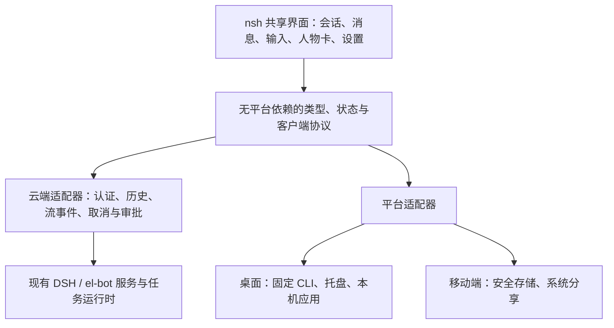

# nsh 跨端客户端迁移评估

核实日期：2026-11-06。对象为 [longbridge/nsh](https://github.com/longbridge/nsh)。这是基于官方文档、发布记录和本仓库代码的评估；本次没有构建 nsh 应用，也没有完成四端实机验收。

## 当前决定：Apple 原生优先

用户进一步明确优先获得完整 macOS / iOS 原生体验，因此当前默认入口改为 SwiftUI，Mac 在必要边界使用 AppKit。`packages/yun-apple` 共享模型、协议与组件，`apps/macos`、`apps/ios` 分别负责平台入口。最低 macOS 14 / iOS 17，原有 Go 控制器继续服务 Mac。

已完成的 nsh TSX + Rust 预览保留作对照，Android / Windows / Web 暂缓。共享代码不会自动实现统一登录和会话同步；iOS 首版只提供原生导航、语言与连接设置，云端业务仍由浏览器进入，原生聊天接口另行推进。当前实现与构建说明见[客户端说明](./client-tool.md)。

以下调研结论记录迁移前的评估依据，不代表四端实机验收已经完成。

## 原始建议

建议将 nsh 作为共享客户端界面的候选，先完成「会话列表 → 流式续聊 → 历史恢复」一个完整试点，再决定是否取代现有客户端。机器人运行时、任务执行、QQ 接入及其权限规则继续由现有后端负责。

nsh 与仓库现有 TypeScript 工作流接近，四端也有实际后端和打包入口，适合进一步验证。不过现有 Go 控制器、macOS SwiftUI 界面、托盘与进程生命周期需要逐项迁移，不能仅凭共享 TSX 认定迁移成本低。

## 已核实的能力

以下支持来自官方平台文档，表示已有实现和命令入口，不代表本项目已验收。许可为 Apache-2.0。[平台概览](https://nsh.dev/docs/platforms/)、[官方仓库](https://github.com/longbridge/nsh)

| 平台 | 后端 | 最低要求 | 官方打包产物 |
| --- | --- | --- | --- |
| macOS | AppKit、Core Animation、CoreText | macOS 14+ | `.app`，默认 ad hoc 签名 |
| iOS | UIKit、CoreText | iOS 15+ | 模拟器 `.app`、签名 `.ipa` |
| Android | Android Views、StaticLayout | Android 9 / API 28+ | 签名 `.apk` |
| Windows | Win32、Direct2D、DirectWrite | Windows 10 1809+ / Windows 11 | 可运行目录和 `.zip` |

四端不是仅列在路线图中。macOS 分发仍需 Developer ID 与公证；Windows 产物是便携目录，现有 NSIS 安装、签名和更新流程仍需接入；Android 文档列出 APK，不能据此认定已有满足商店分发需求的 AAB 流程。Windows 打包在 Windows 完成，不能将本机 Mac 构建视为四端验证。[打包文档](https://nsh.dev/docs/packaging/)

nsh 是 Rust 实现的 UI 引擎。TSX 经自己的编译器调用原生渲染器，采用 signals 响应式更新，没有 React 或虚拟 DOM。各平台原生后端也不是将整页放入 WebView。Web 端是另一套 HTML/CSS 后端；TSX 语法相近不意味着可以直接使用 React/Vue 组件。[JSX 和组件](https://nsh.dev/docs/jsx-and-components/)、[介绍](https://nsh.dev/docs/)

官方 Gallery 的 AI Chat 在桌面通过本机 Claude/Codex CLI 工作，Web 与移动端使用预设流式对话。因此其展示不能证明本项目云端认证和真实续聊已经接通。[示例说明](https://nsh.dev/modules/standard-modules/#gallery)

适合聊天试点的已有能力：

- `fetch` 响应体支持流读取，提供 Web Streams、`AbortController`、编码解码器和 WebSocket。SSE 可基于流解析，但本次未验证浏览器 `EventSource` 兼容性。[网络](https://nsh.dev/docs/networking/)
- `TextView` 明确面向流式 AI Markdown，支持代码、表格、公式及跨段选择，解析在 Rust 中完成。[TextView](https://nsh.dev/elements/text-view/)
- 列表提供虚拟化、历史分页及跟随末尾的行为；用户向上阅读时可以停止自动跟随。[列表](https://nsh.dev/docs/lists/)
- 输入组件支持多行、提交行为、选择与粘贴；文档包含聊天输入框与键盘 inset 的处理。中文输入法、组合输入期间发送、长文本选择和真机键盘动画仍要实测。[表单和键盘](https://nsh.dev/docs/forms-and-keyboard/)
- 桌面提供窗口、系统菜单和快捷键 API；原生组件及宿主消息通道可以扩展平台能力。[桌面 API](https://nsh.dev/modules/nsh-desktop/)、[原生组件](https://nsh.dev/docs/native-components/)、[GPUI 中的宿主通道](https://nsh.dev/docs/gpui/)

## 与当前代码的边界

目前 `apps/el-bot-client` 使用 Go/MyGo；macOS 主窗口使用 AppKit/SwiftUI。`controller.go` 执行固定 CLI 操作，`cloud.go` 使用 `/usr/bin/ssh`、控制 socket 与固定远端命令打开云端 DSH 和管理人物卡。云端承担会话与远程执行，客户端承担托盘、本机程序和权限入口，见 [客户端说明](./client-tool.md)。

移动端应先定位为连接云端的客户端。nsh 的标准模块只是 Node 风格 API 的子集；其进程模块仅用于桌面，`fs/promises` 在 iOS/Android 返回不支持。不能直接把依赖 `node:child_process`、`node:net`、文件锁及本机凭据的现有服务端包移入手机。[标准模块](https://nsh.dev/modules/standard-modules/)

建议架构：

这里的云端客户端协议是建议新增或核实的边界，不是断言当前已存在稳定、可直接消费的完整 API。试点前须确认上游 DSH 接口、认证方式、流事件语义和版本策略；优先复用已验证接口，不依赖页面内部实现。手机访问云端还需要可达的认证连接方案，现有桌面 SSH 入口不能直接等同于移动端接入。桌面桥只暴露经过校验的固定业务动作，不增加通用 shell 执行入口。

可复用的是业务协议、纯 TypeScript 数据模型、设计 token 和后端能力。Go/MyGo 界面与 SwiftUI 界面需要重写或通过宿主保留；现有 Vue/React 界面组件不能直接成为 nsh 组件。

## 需要先验证的成本

1. **系统版本与架构。** 当前客户端配置及 Swift 构建脚本面向 macOS 13；nsh AppKit 后端要求 14+。是否放弃 macOS 13、是否继续提供 Intel Mac 安装包，需在正式替换前确定；已发布工具链主要列出 macOS Apple Silicon，并不证明 Intel 产物已经可用。[macOS 文档](https://nsh.dev/docs/macos/)、[安装文档](https://nsh.dev/docs/installation/)
2. **桌面行为。** 托盘、关窗驻留、隐藏 Dock、重复启动唤起、后台机器人独立运行、打开本机应用和当前图标体系均要回归。`nsh/desktop` API 主要覆盖窗口和菜单；macOS Rust 宿主已有 `keep_alive_on_close` 选项，但它保留窗口和引擎，与当前关窗释放 UI 的策略不同。其余产品行为仍需自有宿主或桥接验证。[桌面 API](https://nsh.dev/modules/nsh-desktop/)、[macOS 宿主](https://github.com/longbridge/nsh/blob/v0.4.0/website/docs/macos.md#L156)
3. **版本稳定性。** 当前最新发布为 2026-11-04 的 `v0.4.0`，发布说明明确包含破坏性 API 修改。官方兼容性承诺从首个记录为兼容的版本开始，而兼容性仓库当前仍表示尚未记录冻结版本。因此试点应固定 CLI、运行时和依赖版本，不追随 `main` 自动升级。[v0.4.0](https://github.com/longbridge/nsh/releases/tag/v0.4.0)、[兼容性说明](https://nsh.dev/docs/compatibility/)、[兼容性记录仓库](https://github.com/longbridge/nsh-compat)
4. **实际体积和性能。** 发布工具链/嵌入 SDK 压缩包大小不是最终安装包大小；官方 demo 的性能也不是本项目聊天体验。应测量 release 安装包、冷启动、长会话内存与流式更新，避免给出未经实测的优势结论。

宿主可以限制网络目标、宿主函数和 VM 资源；原生组件属于宿主代码，不受同一套能力沙箱限制。迁移时继续保留主人鉴权、项目白名单、持久去重、单任务准入、明确审批和固定命令范围。[沙箱和能力](https://nsh.dev/docs/sandbox-and-capabilities/)

## 试点范围与验收门槛

建议新增独立应用目录，例如 `apps/yun-client-nsh`，暂时保留现有桌面入口与安装包。第一阶段只接入同一个云端会话源，完成会话列表、打开历史、发送消息、流式输出、取消以及重启后恢复；暂不将本机机器人管理和复杂部署入口一起迁入。

| 检查项 | 决策所需结果 |
| --- | --- |
| 协议正确性 | 切换会话、断线与重连不串流、不重复发送；取消行为与后端一致；历史恢复不自动重放任务 |
| 手机输入 | iPhone 与 Android 实机验证中文组合输入、换行/发送、粘贴图片、安全区、键盘收放、回到前台 |
| 桌面输入 | macOS 与 Windows 验证中文输入、快捷键、鼠标选择、复制、窗口缩放及系统菜单 |
| 长历史 | 以相同 1,000 条消息样本验证分页、虚拟列表、流式 Markdown 和滚动位置；向上阅读时不被拉回底部 |
| 性能与包体 | 四端记录 release 包体、冷启动、空闲/长会话内存，并与现有客户端或参考实现比较；先定义可接受目标再决定迁移 |
| 分发与系统功能 | 四端产物能安装运行；桌面托盘、单实例和关窗驻留完成最小宿主验证；补齐实际发布要求 |
| 权限边界 | 未登录、无项目权限、重复事件与审批拒绝仍由后端拒绝；客户端不持有模型服务端密钥 |

nsh 的 `nsh test` 提供无界面测试和 `--target macos/windows/ios/android` 平台运行入口，可用来覆盖共享逻辑与交互；它们不能取代中文输入法和系统集成的人工实机验收。[测试文档](https://nsh.dev/docs/testing-and-trace/)

试点通过后，再迁移人物卡和共享设置，最后替换桌面宿主。若输入、系统集成或发布要求出现阻碍，保留现有桌面客户端，并让试点产生的协议与状态层继续服务其他客户端。

## 可定位的核实依据

以下 nsh 源文档链接固定到 `v0.4.0`；兼容性记录引用核实当日的 `main`，后续须重新检查。

| 结论 | 源文件位置 |
| --- | --- |
| macOS 14 最低要求 | [macos.md L22](https://github.com/longbridge/nsh/blob/v0.4.0/website/docs/macos.md#L22) |
| Node 风格 API 仅是子集；移动端文件/进程限制 | [standard-modules.md L49](https://github.com/longbridge/nsh/blob/v0.4.0/website/modules/standard-modules.md#L49)、[L66](https://github.com/longbridge/nsh/blob/v0.4.0/website/modules/standard-modules.md#L66)、[L114](https://github.com/longbridge/nsh/blob/v0.4.0/website/modules/standard-modules.md#L114) |
| AI Chat 移动端 demo 使用预设流式内容 | [standard-modules.md L303](https://github.com/longbridge/nsh/blob/v0.4.0/website/modules/standard-modules.md#L303) |
| 流式 Markdown | [text-view.md L268](https://github.com/longbridge/nsh/blob/v0.4.0/website/elements/text-view.md#L268) |
| 虚拟列表与末尾跟随 | [lists.md L11](https://github.com/longbridge/nsh/blob/v0.4.0/website/docs/lists.md#L11)、[L471](https://github.com/longbridge/nsh/blob/v0.4.0/website/docs/lists.md#L471) |
| 宿主函数白名单；原生组件超出能力沙箱 | [sandbox-and-capabilities.md L213](https://github.com/longbridge/nsh/blob/v0.4.0/website/docs/sandbox-and-capabilities.md#L213)、[L320](https://github.com/longbridge/nsh/blob/v0.4.0/website/docs/sandbox-and-capabilities.md#L320) |
| 兼容性承诺的起点；尚无冻结记录 | [compatibility.md L60](https://github.com/longbridge/nsh/blob/v0.4.0/website/docs/compatibility.md#L60)、[nsh-compat README L21](https://github.com/longbridge/nsh-compat/blob/main/README.md#L21) |

本仓库依据：`apps/el-bot-client/mygo.json:13` 为 macOS 13 配置；`apps/el-bot-client/scripts/build-macos-native.mjs:20` 为 macOS 13 的双架构 Swift 构建；`apps/el-bot-client/cloud.go:27` 为固定 SSH 命令入口；`apps/qq-codex/src/control.ts:5` 起为本机进程、文件及 IPC 依赖。合并或后续改动后行号可能移动。
